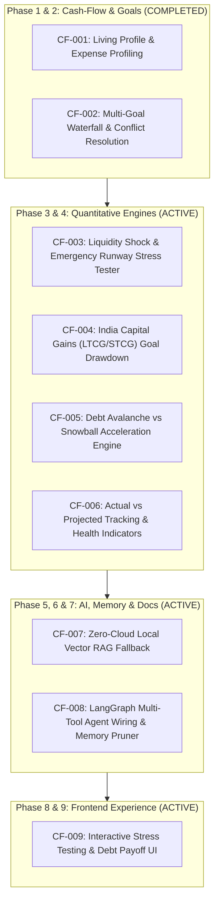

# ChronoFi — Implementation Master Plan

## 1. Executive Objective & Architecture Invariants

ChronoFi is an AI Life Financial Planner engineered to provide verified, deterministic financial roadmap planning, multi-goal conflict resolution, scenario simulation, and persistent conversational intelligence for Indian retail investors.

### Core Architectural Invariants
1. **Authoritative Calculation Invariant**: The LLM is strictly an intent interpreter, natural language extractor, and empathetic narrator. Every rupee, interest rate, future value, tax deduction, and probability must originate from deterministic, unit-tested Python functions.
2. **Common Random Numbers (CRN)**: Monte Carlo scenario simulations use synchronized pseudo-random streams (`np.random.default_rng(seed)`) to isolate causal decision effects from stochastic noise.
3. **Strict Separation of Simulation vs Fact**: Scenario simulations operate on isolated in-memory or read-only `ScenarioRecord` stores. No actual `Asset`, `Liability`, or `Goal` is mutated without explicit, verified user confirmation.
4. **Data Isolation & Tenant Security**: All database queries and checkpointer thread operations enforce server-side `user_id == current_user.id` resolved exclusively from verified JWTs.

---

## 2. Comprehensive Implementation Roadmap

---

## 3. Detailed Workstream Specifications

### Workstream A: Liquidity Shock & Emergency Stress Tester (CF-003)
- **Problem**: Users cannot simulate acute life shocks (job loss for 6 months, ₹5 Lakh medical emergency, or 25% salary cut).
- **Engine**: Computes liquid burn rate, asset liquidation waterfall (`Cash` $\rightarrow$ `FD` $\rightarrow$ `Liquid/Debt` $\rightarrow$ `Equity`), month of cash insolvency, and recovery time.
- **Deliverables**:
  - `engine/stress_engine.py`: Deterministic stress testing algorithms.
  - `api/stress_routes.py`: Endpoints for running liquidity shock simulations.
  - Integration with user profile and assets.

### Workstream B: India Capital Gains (LTCG/STCG) Goal Drawdown (CF-004)
- **Problem**: Goal maturity projections ignore Indian tax friction (Budget 2024 LTCG rules: 12.5% above ₹1.25 Lakh exemption for equity, 20% STCG, slab-rate debt/FD, tax-free PPF). Goals appear fully funded but suffer a 10-15% shortfall upon post-tax withdrawal.
- **Engine**: Calculates pre-tax vs post-tax maturity corpuses across asset categories.
- **Deliverables**:
  - `engine/tax_drawdown.py`: Post-tax net corpus calculators.
  - Integration into `calculate_multi_goal_waterfall`.

### Workstream C: Debt Avalanche vs Snowball Optimizer (CF-005)
- **Problem**: Users with multiple liabilities pay default EMIs without knowing whether prioritizing higher-rate debt (Avalanche) or smaller-balance debt (Snowball) saves more money and accelerates debt-free milestones.
- **Engine**: Simulates month-by-month repayment schedules, total interest paid, debt-free date, and discretionary prepayment impacts.
- **Deliverables**:
  - `engine/debt_engine.py`: Amortization and payoff schedule simulator.
  - `api/debt_routes.py`: REST endpoints for debt payoff optimization.

### Workstream D: Actual-versus-Projected Tracking & Financial Health (CF-006)
- **Problem**: Users lack a way to measure variance between original projected roadmaps and actual net worth progress over time.
- **Deliverables**:
  - Historical snapshot logging and tracking metrics (Savings Rate, Debt-to-Income, Liquidity Ratio, Solvency Ratio).

### Workstream E: Local-First Vector Search Fallback for Document RAG (CF-007)
- **Problem**: 32 tests in CI are skipped because they depend on external cloud Pinecone/Gemini credentials.
- **Engine**: Provide a robust local in-memory cosine-similarity / TF-IDF embedding fallback so document retrieval and prompt injection tests execute and pass offline.

### Workstream F: LangGraph Agent Tooling & UI Integration (CF-008 & CF-009)
- **Problem**: AI agents and the frontend dashboard must expose these new capabilities directly to the user in a cohesive interface.
